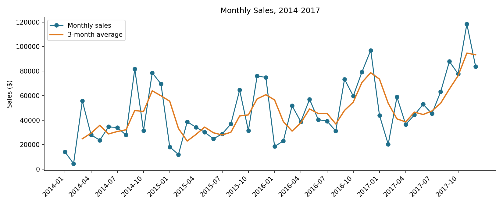
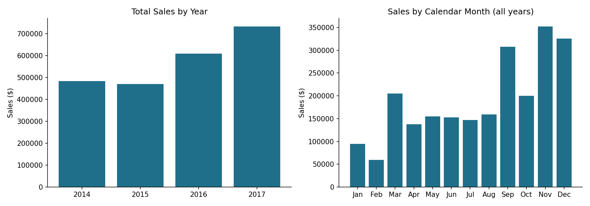
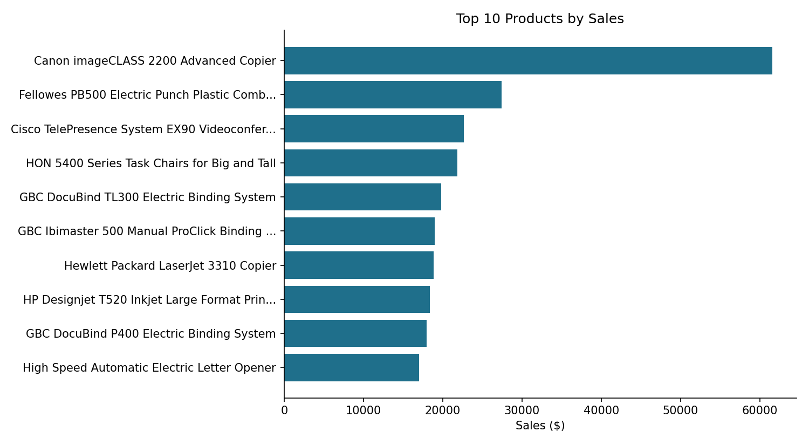
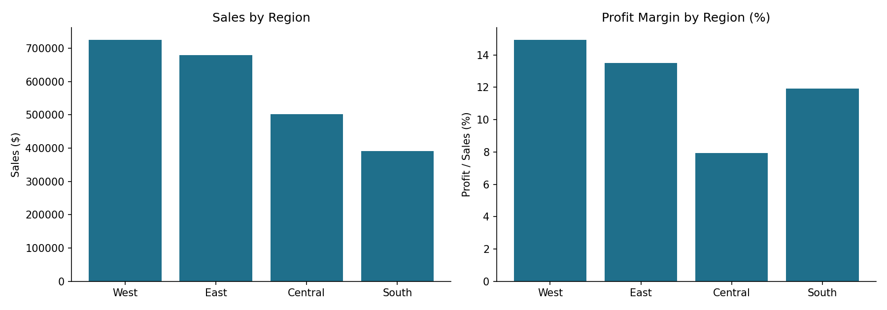
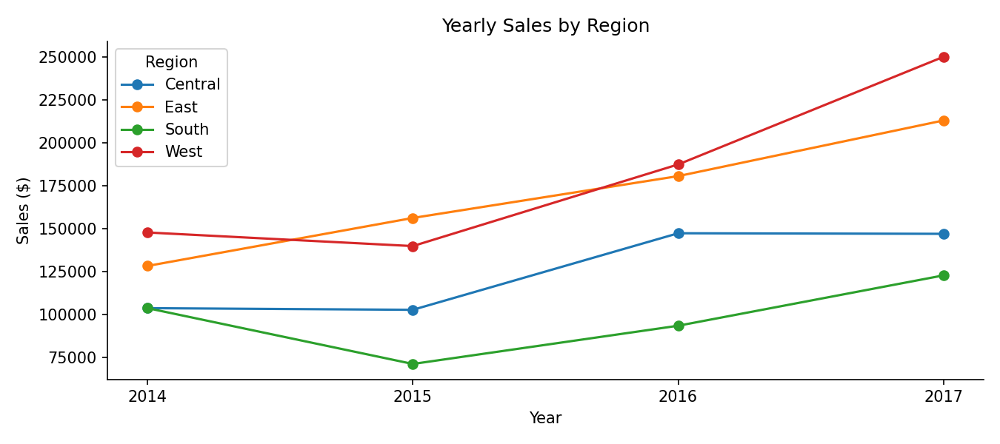
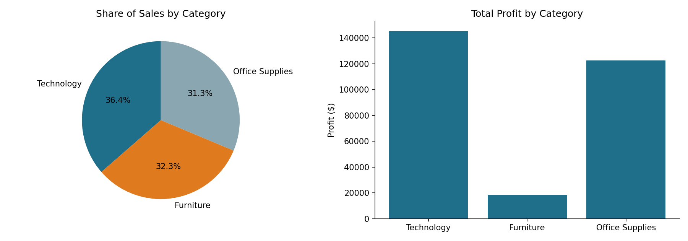
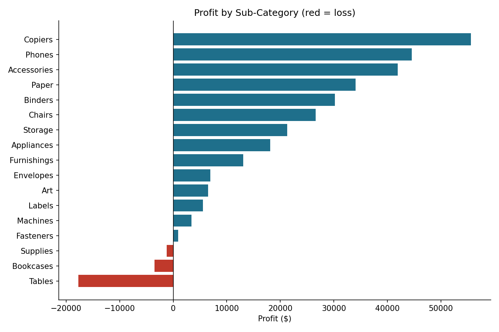
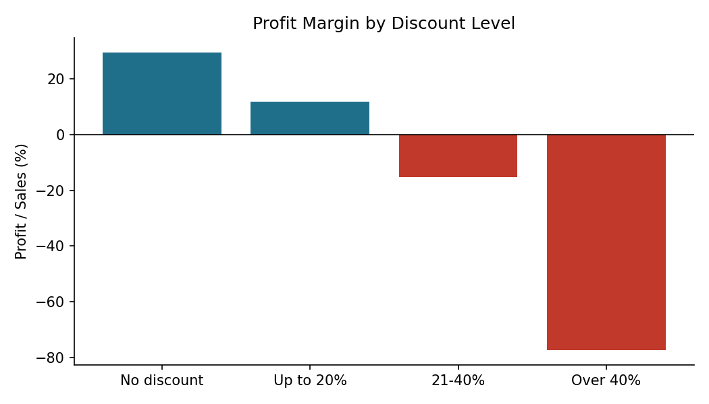

# Sales Data Analysis Dashboard - Project Report

**Author:** Your Name  **Role:** Data Analysis Intern  **Tools:** Python (Pandas, NumPy, Matplotlib), HTML/Chart.js

## 1. Introduction
A retail business collects thousands of sales records but needs clear answers: How much do we sell? When? Which products, regions and categories matter most? This project analyses the Superstore sales dataset to answer these questions and presents the results in a notebook, a report and an interactive dashboard.

## 2. Dataset
The dataset has 9,994 rows and 21 columns covering orders from 3 January 2014 to 30 December 2017 in four US regions. One row is one product line inside an order, so one order can have several rows. There are 5,009 unique orders, 793 customers and 1,850 product names. The columns used most are Order ID, Order Date, Region, Category, Sub-Category, Product Name, Sales, Discount and Profit.

## 3. Data Understanding and Quality Checks
| Check | Result |
|---|---|
| Missing values | None |
| Exact duplicates | None |
| Duplicates ignoring `Row ID` | 1 repeated row (same order, product and quantity) |
| Extra spaces in product names | 16 values |
| Sales <= 0, Quantity <= 0 | None |
| Ship date before order date | None |
| Loss-making lines (Profit < 0) | 1,871 |

The dataset was already quite clean. The only real problems were one hidden duplicate (hidden because `Row ID` is different for each row) and trailing spaces.

## 4. Data Cleaning
1. Stripped extra spaces from text columns.
2. Converted `Order Date` and `Ship Date` to date format.
3. Removed the one duplicate row (9,994 -> 9,993 rows).
4. Added missing-value handling (drop rows missing key fields, fill Profit with the median and Discount with 0). It changed nothing here because no values were missing, but it keeps the notebook safe for other files.
5. Added Year, Month, Month Name and Year-Month columns.

The cleaned file is `data/superstore_cleaned.csv`.

## 5. Analysis and Results

### 5.1 Key numbers
| Measure | Value |
|---|---|
| Total Sales | $2,296,919.49 |
| Total Orders | 5,009 |
| Average order value | $458.56 |
| Total Profit | $286,409.08 (12.5% margin) |

*Total Orders is the number of unique Order IDs, not the number of rows.*

### 5.2 Monthly sales and trend

- Sales by year: 2014 $483,966; 2015 $470,533 (-2.8%); 2016 $609,206 (+29.5%); 2017 $733,215 (+20.4%).
- Best month: November 2017 ($118,447.82). Worst month: February 2014 ($4,519.89).
- A straight-line trend fitted with NumPy shows sales rising by about $903 per month.
- Each year has the same shape: low at the start, a rise in September and a peak in November and December. Oct-Dec produce 38.2% of all sales. Across all years, November ($352,461), December ($325,294) and September ($307,650) are the top months, and February ($59,751) is the lowest.

### 5.3 Top 10 products

| # | Product | Sales | Profit |
|---|---|---|---|
| 1 | Canon imageCLASS 2200 Advanced Copier | $61,599.82 | $25,199.93 |
| 2 | Fellowes PB500 Electric Punch Plastic Comb Binding Machine with Manual Bind | $27,453.38 | $7,753.04 |
| 3 | Cisco TelePresence System EX90 Videoconferencing Unit | $22,638.48 | -$1,811.08 |
| 4 | HON 5400 Series Task Chairs for Big and Tall | $21,870.58 | $0.00 |
| 5 | GBC DocuBind TL300 Electric Binding System | $19,823.48 | $2,233.51 |
| 6 | GBC Ibimaster 500 Manual ProClick Binding System | $19,024.50 | $760.98 |
| 7 | Hewlett Packard LaserJet 3310 Copier | $18,839.69 | $6,983.88 |
| 8 | HP Designjet T520 Inkjet Large Format Printer - 24" Color | $18,374.90 | $4,094.98 |
| 9 | GBC DocuBind P400 Electric Binding System | $17,965.07 | -$1,878.17 |
| 10 | High Speed Automatic Electric Letter Opener | $17,030.31 | -$262.00 |

The top 10 together are 10.6% of total sales. Three of them lose money.

### 5.4 Regional analysis

| Region | Sales | Share | Orders | Profit margin |
|---|---|---|---|---|
| West | $725,458 | 31.6% | 1,611 | 14.9% |
| East | $678,500 | 29.5% | 1,401 | 13.5% |
| Central | $501,240 | 21.8% | 1,175 | 7.9% |
| South | $391,722 | 17.1% | 822 | 11.9% |

West and East grew fastest from 2014 to 2017 (about +69% and +66%). Central grew about 42% overall but stayed flat between 2016 and 2017. South fell by about 31% in 2015 and then recovered.

### 5.5 Category analysis

| Category | Sales | Share | Profit | Margin |
|---|---|---|---|---|
| Technology | $836,154 | 36.4% | $145,455 | 17.4% |
| Furniture | $741,718 | 32.3% | $18,463 | 2.5% |
| Office Supplies | $719,047 | 31.3% | $122,491 | 17.0% |

The three categories sell similar amounts, but Furniture earns very little profit. Inside it, Tables (-$17,725) and Bookcases (-$3,473) lose money; Supplies (Office Supplies, -$1,189) is the third loss-maker.

### 5.6 Discounts
| Discount level | Profit margin |
|---|---|
| No discount | 29.5% |
| Up to 20% | 11.9% |
| 21-40% | -15.3% |
| Over 40% | -77.4% |

## 6. Business Insights and Recommendations
1. **Sales are growing.** 2016 and 2017 grew by about 29% and 20%. *Recommendation:* keep the strategies used since 2016 and check why 2015 was weak.
2. **Sales are seasonal.** 38.2% of sales fall in Oct-Dec. *Recommendation:* plan stock and staff for the end of the year, and run promotions in Jan-Feb when sales are low.
3. **West and East lead; Central is weak on profit.** Central's margin is 7.9% and its sales were flat in 2017. *Recommendation:* look at Central's discounts and costs.
4. **Furniture has a margin of only 2.5%.** *Recommendation:* review pricing and discounts on Tables and Bookcases.
5. **Heavy discounts destroy profit.** Lines discounted above 20% lose money, while lines with no discount have a margin of 29.5%. These lines are about 14% of all rows. *Recommendation:* set a limit on discounts.
6. **Sales are not dependent on a few products.** The top 10 give 10.6% of sales. *Recommendation:* review the three top-10 products that lose money.
7. **Technology is the best category** for both sales (36.4%) and margin (17.4%). *Recommendation:* protect and expand it.

*These insights describe patterns in the data; I did not test the causes. For example, the link between discounts and losses is clear, but the data cannot tell why the discounts were given.*

## 7. Dashboard
`dashboard/index.html` shows Total Sales, Total Orders, average order value and profit margin, plus charts for monthly sales, top 10 products, region and category. The Year, Region and Category filters update everything. The numbers match the notebook (checked for several filter combinations).

## 8. Limitations
- Sample dataset, four years only.
- Findings are descriptive; no significance tests or forecasts.
- Top 10 products are grouped by name; 16 names have more than one Product ID.

## 9. Conclusion
The business is growing, has a strong end-of-year season, and sells across all regions and categories. Its main weakness is profit, not sales: heavy discounts, Furniture and the Central region reduce margin. Fixing these would improve results without needing more sales.

## 10. How to Reproduce
See the "How to Run" section in `README.md`.
